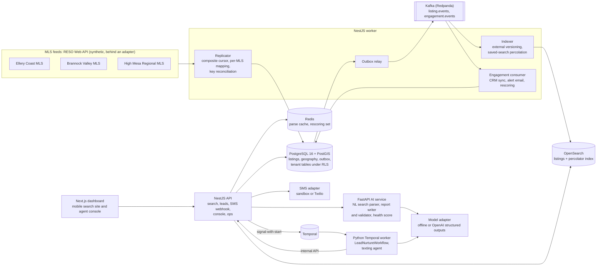

# AI IDX search and lead engagement

A multi-office real estate platform that replicates MLS listings over the RESO Web API, serves a mobile-first IDX search site per office with natural-language search, and turns every web inquiry into a text conversation within seconds. A durable Temporal workflow per lead qualifies timeline, budget and pre-approval, offers real showing slots from the agent's calendar, books the showing or hands off to a person, and keeps a day 1, 3 and 7 then monthly follow-up cadence that any reply resets. Around that sit a transparent relationship health score with next best actions, PostGIS-computed farm-area market reports whose every figure is checked before sending, and an agent console that shows all of it.

This is a reference implementation of the architecture behind a platform I built for a regional residential brokerage group with 12 offices and about 300 agents across three MLS markets. The production build is under NDA, so a few integrations are abstracted behind adapters: the MLS vendor feeds, SMS and email delivery, the CRM, the identity provider and the map tiles. It runs on synthetic data, and every company, place, person, phone number and figure in it is made up.

[](https://github.com/AlexKurinets/ai-idx-search-and-lead-engagement/actions/workflows/ci.yml)

## Architecture



The write path is Postgres first. The replicator commits each page of listings, its outbox events, any mapping issues and the advanced cursor in one transaction; the relay publishes committed outbox rows to Kafka; the indexer keeps OpenSearch in step. Every service reads the database it owns: the AI service and the Temporal worker never write to Postgres, they call the API, which enforces tenancy, consent and the outbox.

| Service | Stack | Role |
|---|---|---|
| `services/api` | NestJS 11, node-postgres, kafkajs, OpenSearch client, Temporal client | REST API and the worker process (replicator, relay, indexer, engagement consumers, schedulers) |
| `services/ai` | FastAPI, Pydantic, Temporal Python SDK | NL search parsing, texting agent and its workflow, scoring, report drafting and validation |
| `services/web` | Next.js 15, React 19, Tailwind, MapLibre GL | Mobile search site per office and the agent console |
| `services/mls-sim` | FastAPI | Synthetic RESO Web API for three invented MLS markets, with quirks, rate limits and live market changes |
| `tools/seed` | Python | Offices, agents, contacts and history, plus 120 live leads driven through the real texting pipeline |

## Design decisions

**Replication uses a composite cursor, never a timestamp alone.** A watermark of `ModificationTimestamp gt W` silently skips listings when a page boundary falls inside a group of records sharing one timestamp, and MLS bulk updates produce exactly that. The replicator orders by `ModificationTimestamp, ListingKey` and resumes strictly after the last pair (`services/api/src/replication/cursor.ts`). Each request is built from the cursor rather than an offset-based `@odata.nextLink`, because offsets shift when records change between requests. The simulator stamps 300 listings with one timestamp every five minutes, and `services/mls-sim/tests/test_feed.py` shows a timestamp-only watermark losing exactly 200 of 320 records while the composite cursor gets all of them. Timestamps compare at the millisecond precision the feed emits.

**Feed quirks live in mapping files, and unknown values are held, not guessed.** Each MLS has a YAML file that extends a common Data Dictionary mapping (`services/api/mappings`). The simulated Brannock Valley feed sends display-name enumerations, prices as strings and the neighborhood in a local field; High Mesa omits `LivingArea` and sends a non-standard `Contingent` status. An unmapped lookup value stores the listing as `Unmapped`, keeps it off the public index and shows up in the pipeline page for review. A periodic key reconciliation removes listings that vanished from a feed without a status change. The replicator honors `429 Retry-After` and refreshes its OAuth token on `401`.

**A transactional outbox feeds Kafka, and the indexer cannot regress a document.** Listing writes and their events commit together; the relay publishes at least once, keyed by listing id so one listing's events stay ordered. The indexer reads current rows instead of trusting payloads and writes with OpenSearch external versioning (the MLS modification time in milliseconds), so a late event is rejected rather than overwriting newer data. New listings, price drops and back-on-market changes are percolated against saved searches stored as percolator queries, which turns alerts into one query per batch instead of one per saved search. End-to-end lag from MLS change to searchable is measured per listing and shown on the pipeline page.

**Tenancy is enforced by Postgres row-level security.** A tenant is one office with its own search site, phone number, agents and lead pool. The API connects as a role without `BYPASSRLS` and sets `app.tenant_id` with `set_config(..., true)` inside each transaction, so a pooled connection can never carry the previous request's tenant, and a query that forgets a `WHERE` clause still sees one office. The policy wraps the setting in `NULLIF(..., '')` because a custom setting reads back as an empty string after `SET LOCAL` ends, and `''::uuid` would raise instead of matching nothing. A separate platform role is used only by inherently cross-tenant work: replication, the relay, the indexer and the ops endpoints. IDX display is limited to the MLS feeds an office participates in and to listings with `InternetEntireListingDisplayYN` set; withheld addresses never reach the index.

**Natural-language search: rules first, the model only for leftovers, and the model never writes a query.** A deterministic parser explains most queries completely, records which words it consumed, and computes coverage. Only a query with unexplained words goes to the model adapter, which receives what was already understood plus the leftover words and must answer in a strict JSON schema; places come back verbatim and are resolved by a gazetteer, so the model never chooses an id. The merged result is validated against the same filter contract in Python and again in the API, and `services/api/src/search/query-builder.ts` is the only code that builds OpenSearch DSL, always with the office's MLS scope and the IDX flag. Parses are cached in Redis by normalized text plus the filter state they refine. The interpreted filters come back as removable chips, and follow-ups like "cheaper" or "with a pool" refine the current state. Requests about safety, schools or who lives somewhere never become filters; the search shows a note instead.

**The texting engine is a durable Temporal workflow per conversation.** The first text goes out within a second or two of the inquiry. After that the workflow waits for a reply signal or a durable timer for the next follow-up (day 1, 3 and 7 after the last exchange, then monthly for five months), and any reply resets the cadence. STOP, START and HELP are handled in the API before anything reaches the model. Consent, quiet hours and a daily cap are enforced in `services/api/src/messaging/policy.ts`: a reply to someone who just wrote goes out at any hour, while a follow-up due at 10 p.m. comes back as deferred until 8 a.m. local time and the workflow holds it on a timer, dropping it if the lead texts first. Every send carries an idempotency key from the workflow id and a sequence number, so a retried activity never texts twice. Showing times come from the agent's working hours minus booked appointments, and a unique index on agent and start time makes a double booking impossible. Fair Housing questions, requests for a person and offer or contract questions are handed off by deterministic rules; a model decision that fails a guardrail (length, steering language, an unsupported price, a promise, or a slot that was never offered) is replaced by the deterministic decision. An agent can take over any thread from the console, which signals the workflow to stop.

**The relationship score is explainable.** Each engagement signal has a weight and decays with a 14-day half-life, the decayed sum maps onto 0 to 100 with a saturating curve, and the components are stored with the score so an agent can see why a contact is cooling. Next best actions follow from the band and the contact's state, for example "call today" for a hot lead with no showing, or the count of new saved-search matches for a warm one. Contacts touched by an event are rescored within a minute.

**Farm reports: numbers from SQL, words from the model, and a validator between them.** PostGIS computes the market statistics inside each agent's farm polygon (`ST_Within`, medians by `percentile_cont`, prices rounded to the nearest $1,000). The writer may only restate them. `services/ai/app/reports/validator.py` parses every figure in the draft with its unit and accepts only the stats values and the roundings a writer legitimately uses; a failing draft is regenerated once with the offending figures named, and otherwise held as `needs_review`. An agent's edits are checked again before the report can be sent to the homeowners inside the polygon who consented to email.

**One model adapter, offline by default.** Production used an OpenAI model with structured outputs. Here `LLM_PROVIDER=offline` runs a deterministic adapter that implements the same contracts with rules, so the tests, CI and the demo never call a paid API; `LLM_PROVIDER=openai` with `OPENAI_API_KEY` switches it on.

**A map without a tile server.** The search map is MapLibre GL over the synthetic geography itself: neighborhood polygons shaded by median list price, parks and the river. Below zoom 14 the API returns `geotile_grid` clusters for the viewport; above it, individual listings.

## Running it

Requires Docker with Compose v2.20 or later and about 6 GB of memory for the stack.

```bash
cp .env.example .env          # optional: change host ports or switch the model adapter
docker compose up --build -d
docker compose logs -f seed   # about 5 to 10 minutes: backfill, offices, live leads, scores, reports
```

The seed waits for the first replication pass, then writes 12 offices, 300 agents, about 2,500 contacts with 90 days of engagement history and 36 farm areas, sends 120 live inquiries whose scripted replies travel the signed webhook path, scores every contact, drafts every farm report and runs a batch of searches. It finishes with a one-line summary and exits 0.

| What | URL |
|---|---|
| Office search site (phone-friendly) | http://localhost:3100/s/old-quay |
| Agent console | http://localhost:3100/console |
| IDX pipeline | http://localhost:3100/console/pipeline |
| Sandbox phone | http://localhost:3100/console/phone |
| API | http://localhost:4100/healthz |
| Temporal UI | http://localhost:8243 |
| Synthetic RESO Web API | http://localhost:8110/ECM/odata/Property (OAuth2 client credentials) |

To watch a lead end to end: open a listing, submit "Ask about this home" with `(202) 555-0199` (reserved for demos), then open the sandbox phone with that number and reply. Texts sent between 9 p.m. and 8 a.m. in the office's time zone behave as described above: replies go out, proactive follow-ups wait.

## Testing

```bash
# NestJS: typecheck, unit tests, and integration tests against PostGIS (the Compose Postgres on :5442)
cd services/api && npm ci && npm run typecheck && npm test && npm run test:int

# AI service: lint and tests, including Temporal time-skipping workflow tests and the NL search eval
cd services/ai && pip install -e ".[dev]" && ruff check . && pytest -q

# Synthetic MLS
cd services/mls-sim && pip install -e ".[dev]" && ruff check . && pytest -q

# Web: typecheck, unit tests, production build
cd services/web && npm ci && npm run typecheck && npm test && npm run build

# End to end, against a running and seeded stack
bash scripts/smoke.sh
```

The smoke test checks that on-market listings and the search index agree, that a natural-language query is parsed by rules alone into the expected filters, that steering terms never become filters, that a new lead gets a first text and a booked showing through the sandbox handset, that the report validator rejects invented figures, and that every dashboard page renders. CI runs all of the above, then brings the Compose stack up, waits for the seed and runs the smoke test.

The natural-language evaluation set (`services/ai/evals`) has 111 synthetic queries; it currently scores 102 of 111 exact filter matches, with all 87 rules-only cases passing and 15 of 24 cases that needed the model adapter. The failures are listed on the pipeline page. The set was written alongside the rules, so it catches regressions rather than measuring real-world accuracy.

## Deliberately left out

- Real MLS vendor connections, the Media resource and listing photos; the simulator stands in behind the same OAuth2 and OData interface.
- Live SMS and email delivery. The Twilio adapter is implemented but not exercised; the sandbox records messages instead, and email goes to a table.
- WhatsApp, Instagram and Facebook messaging channels.
- A CRM vendor adapter; lifecycle events are written to a sync log by a sandbox adapter.
- Identity-provider login. A dev token issuer signs the same claims and only runs with `AUTH_MODE=dev`.
- Map tiles from a hosted provider, and vector search over listing remarks.
- Infrastructure as code for AWS (ECS, RDS, MSK, OpenSearch Service), high availability, and Temporal beyond the single-binary dev server.

## Layout

```
data/geo/            synthetic geography shared by every service (generated by tools/geo)
db/migrations/       platform tables, tenant tables with RLS, grants
services/api/        NestJS API and worker; mappings/ holds the per-MLS mapping files
services/ai/         FastAPI app, texting agent, Temporal workflow and worker, evals
services/mls-sim/    synthetic RESO Web API
services/web/        Next.js search site and agent console
tools/seed/          seed script and scripted buyer personas
scripts/smoke.sh     end-to-end smoke test
```

## License

MIT, see [LICENSE](LICENSE).
